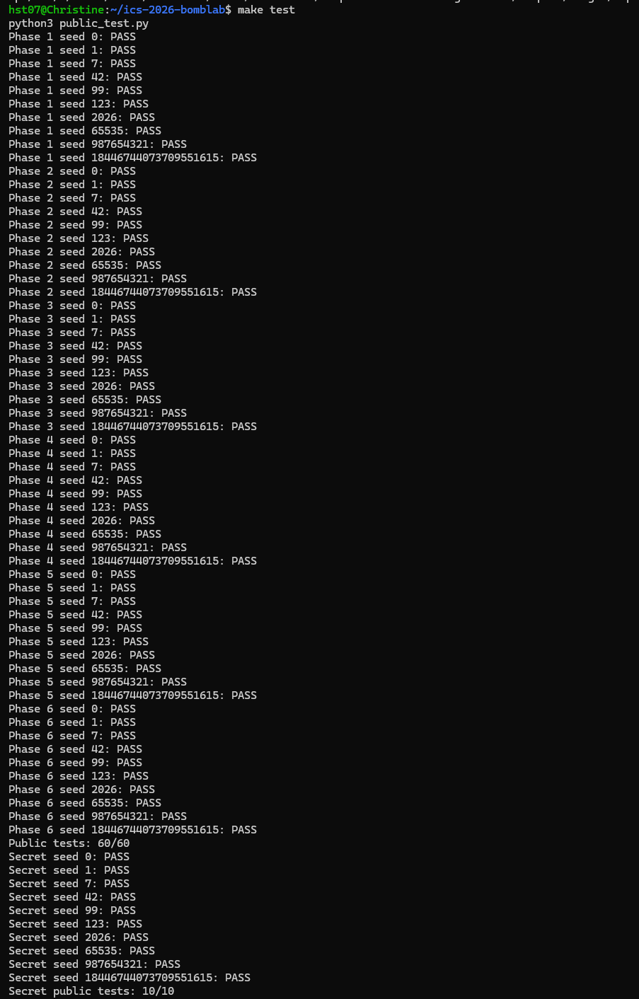
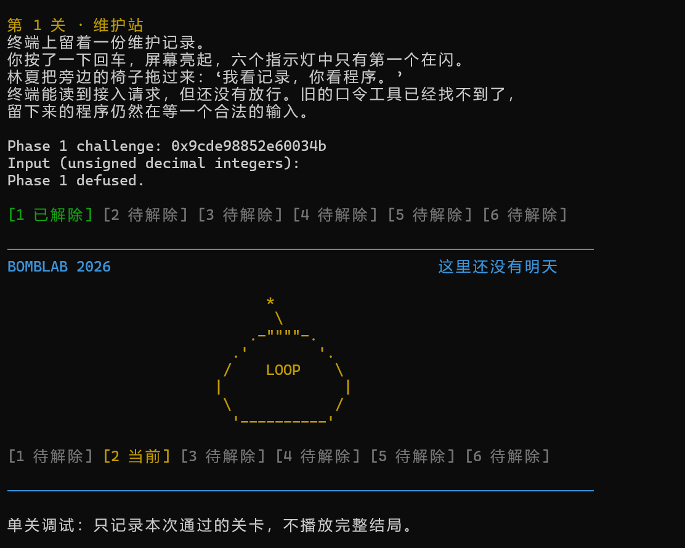
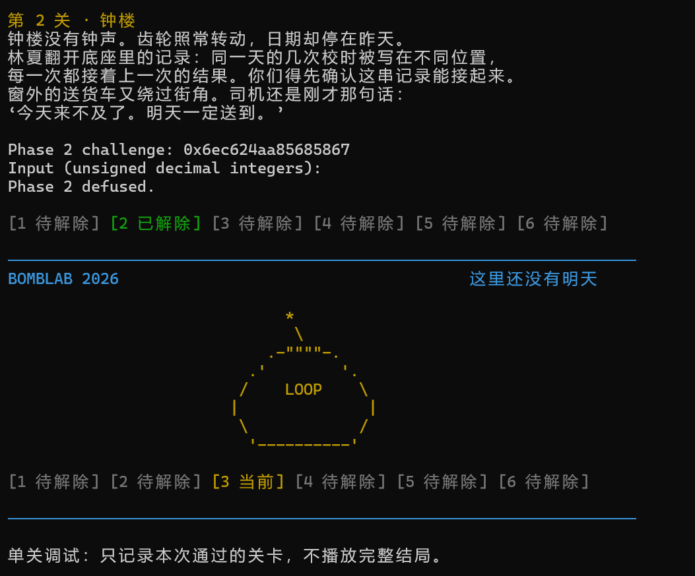
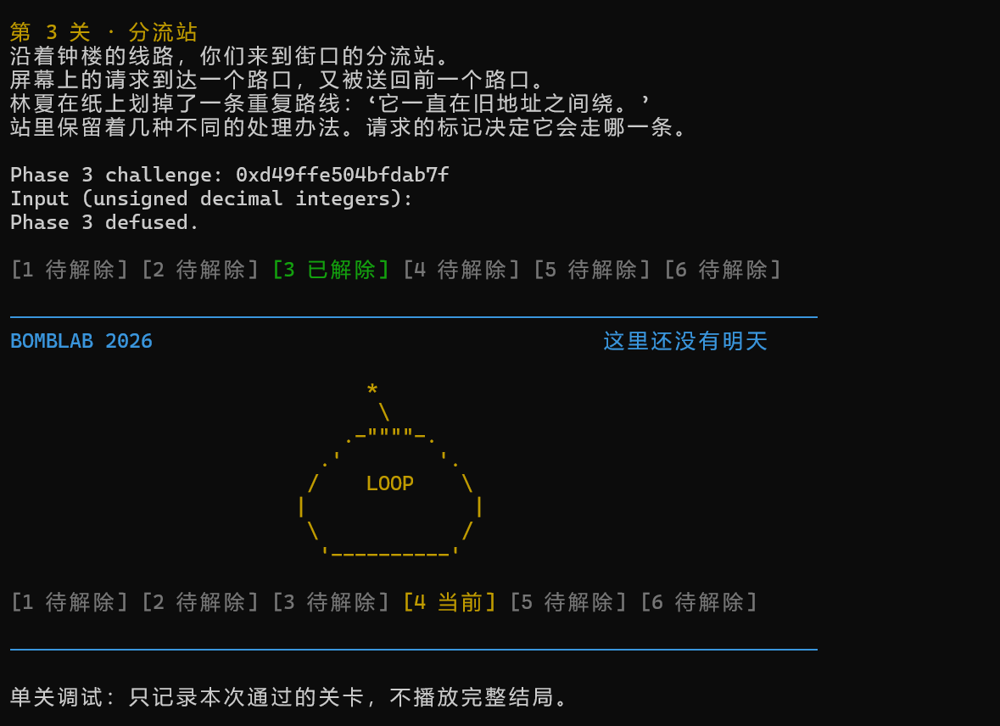
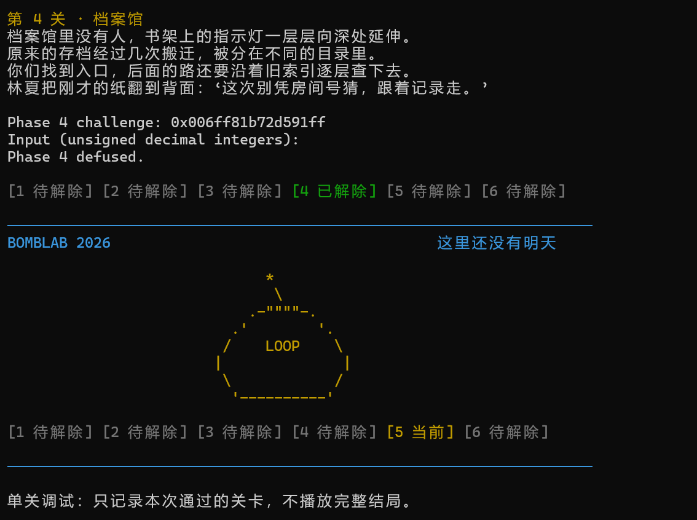
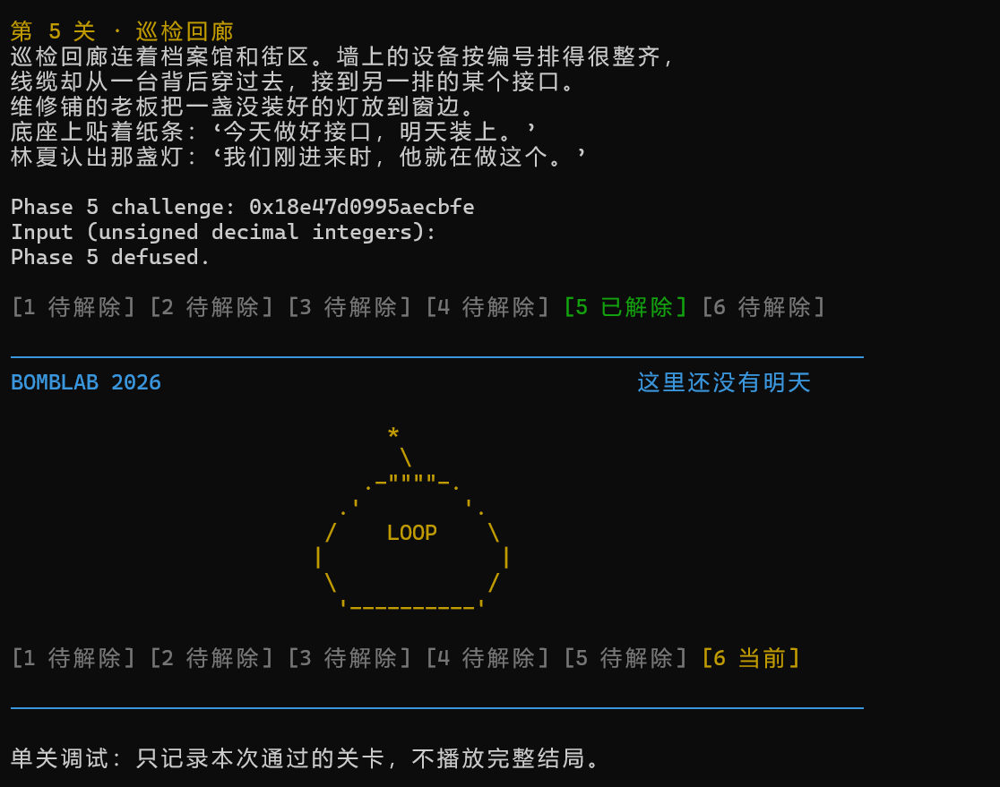
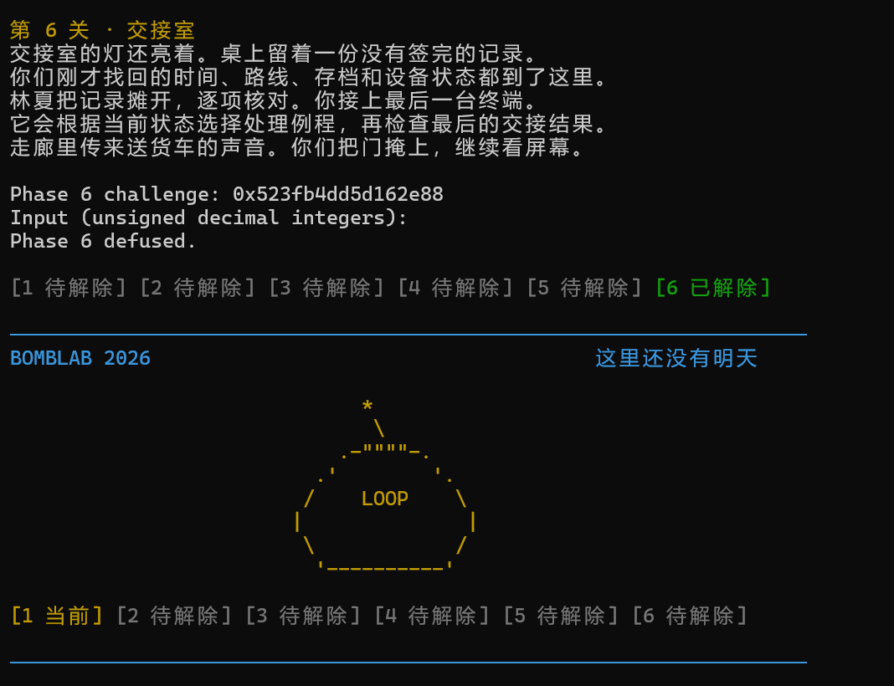
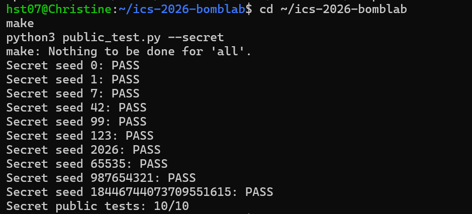
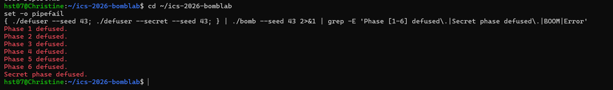

# BombLab 实验报告


## 一、实验目的

本实验要求我分析个人炸弹 `bomb` 的 x86-64 汇编，理解函数调用、整数运算、分支、循环、递归、链表和函数指针表，再在 `defuser.c` 中实现通用求解程序。程序应根据每次运行得到的 challenge 计算口令，而不是记住某次运行的固定答案。

## 二、实验环境与工具

- 环境：WSL 2，Ubuntu 24.04.4 LTS，Linux x86-64
- 编译：GCC、GNU Make；Makefile 使用 C11、`-O2`、`-Wall`、`-Wextra`、`-Wpedantic`、`-Werror`
- 分析：`objdump`、GDB
- 测试：`python3 public_test.py`
- 实现文件：`defuser.c`

## 三、分析和实现过程

我一开始把汇编当作一串难懂的指令。后来按“函数入口参数 → 运算 → 分支或调用 → 比较输入”的顺序读，先用 `objdump` 导出单个函数，再用 GDB 查看跳转表和数据结构。每完成一关，我重新编译并运行公开测试；遇到 `wrong_answer` 时，就回到对应的比较指令检查计算关系和参数来源。

### Phase 1：函数调用与返回值

我先追踪 `challenge` 的低 32 位和高 32 位，按汇编中的调用顺序还原 `step0`、`step2` 和最后的输出值。32 位无符号运算按模 (2^{32}) 回绕，因此实现中使用 `uint32_t`。

令 `low = (uint32_t)challenge`、`high = (uint32_t)(challenge >> 32)`：

```text
step2 = (low XOR 0xbcbb) + 4 * high
step0 = (5 * low) XOR ((uint32_t)(challenge >> 16) + 0x40a4)
answer = (step0 + 8 * step2) XOR 0x1b04
```

关键是把每个中间结果看作 32 位无符号数，避免错误地按无限精度整数计算。

`phase_01` 本身负责解析一个整数、调用计算函数并比较结果。以下关键调用路径来自反汇编：

```asm
lea    -0x14(%rbp),%rdx
mov    $0x403189,%esi
call   __isoc99_sscanf@plt
cmp    $0x1,%eax
jne    0x4020b3 <phase_01+0x23>
mov    %r12,%rdi
call   0x402050 <p1_compute>
cmp    %eax,-0x14(%rbp)
sete   %al
```

这段说明输入必须解析出一个整数，且该整数要与 `p1_compute(challenge)` 的返回值相等。`p1_compute` 再从 challenge 中提取不同位段，并依次调用三个 helper：

```asm
mov    %rdi,%rax
mov    %rdi,%rdx
mov    %edi,%esi
shr    $0x20,%rax
mov    %esi,%r8d
shr    $0x10,%rdx
mov    %eax,%edi
call   0x402040 <p1_step2>
mov    %rdx,%rsi
mov    %r8d,%edi
mov    %ecx,%eax
call   0x402020 <p1_step0>
mov    %ecx,%esi
mov    %eax,%edi
call   0x402030 <p1_step1>
```

`shr $0x20` 提取 challenge 高 32 位，`shr $0x10` 准备中间位段；随后 helper 的调用顺序对应 `step2`、`step0`、`step1`。结合各 helper 的计算关系，得到上面的最终答案公式。

三个 helper 的关键指令如下：

```asm
; p1_step2(高32位, 低32位)：低32位先 XOR 0xbcbb，再加 4 倍高32位
xor    $0xbcbb,%esi
lea    (%rsi,%rdi,4),%eax

; p1_step0(low, challenge >> 16)：5*low XOR ((challenge >> 16) + 0x40a4)
lea    (%rdi,%rdi,4),%eax
add    $0x40a4,%esi
xor    %esi,%eax

; p1_step1(step0, step2)：step0 + 8*step2，再 XOR 0x1b04
lea    (%rdi,%rsi,8),%eax
xor    $0x1b04,%eax
```

这分别对应 `step2`、`step0` 和最终合并步骤，因此公式中的乘数、加数和异或常数都能在反汇编中找到。

### Phase 2：数组与递推

这关读取六个整数。第一个数直接由 challenge 的一段位得到；之后每个数都依赖前一个输入，因此它是递推而不是六个互不相关的公式。

```text
values[0] = (((uint32_t)(challenge >> 30)) & 0x7f) XOR 0x19
对于 i = 1..5：
    part = (((uint32_t)(challenge >> (7 + 5*(i-1)))) & 0xf)
    values[i] = (part + 6) XOR (3 * values[i-1] - i)
```

反汇编中的循环主体直接体现了递推：`lea (%rsi,%rsi,2),%esi` 先计算前一项的 3 倍，`sub %edx,%esi` 再减去循环下标 `i`；同时 `shr %cl,%eax`、`and $0xf,%eax` 取 challenge 对应的 4 位片段，`add $0x6,%eax` 后与递推部分异或：

```asm
mov    %r13d,%eax
lea    (%rsi,%rsi,2),%esi
shr    %cl,%eax
sub    %edx,%esi
and    $0xf,%eax
add    $0x6,%eax
xor    %esi,%eax
```

循环下标从 1 开始，移位量从 7 开始、每轮增加 5；`add $0x5,%ecx` 和循环比较确定了这一步进关系。首项路径中的 `shr $0x1e,%eax`、`and $0x7f,%eax`、`xor $0x19,%eax` 对应首项公式。

需要特别注意循环变量 `i` 同时参与递推减法，而移位量按每轮增加 5 位；下标引用前一个输入 `values[i-1]`。运算在 `uint32_t` 中自然按模 `2^32` 回绕。

### Phase 3：分支与跳转表

第一个数是 `challenge & 7`，用于选择分支；第二个数由 `x = (uint32_t)(challenge >> 32) XOR (uint32_t)(challenge >> 3)` 经过对应分支函数计算。

我用 GDB 查看了地址 `0x405820` 的跳转表，确认表项顺序并不是函数编号的自然顺序：

```text
0x405820: 0x402278  0x402280
0x405830: 0x402288  0x402290
0x405840: 0x402298  0x4022a0
0x405850: 0x402268  0x402270
```

这些地址是 `p3_dispatch` 内部不同分支的入口。把表项按 `challenge & 7` 的索引顺序排列，才能得到下面的映射；只按分支函数编号排序会选错计算式。

| 第一个数 | 被调用的函数 | 第二个数的计算 |
| ---: | --- | --- |
| 0 | `p3_case_2` | `(x XOR 0xc604) + (x >> 1)` |
| 1 | `p3_case_6` | `(x XOR 0x42e5) + (x >> 1)` |
| 2 | `p3_case_5` | `3*x + 0xae0a` |
| 3 | `p3_case_0` | `5*x + 0x997c` |
| 4 | `p3_case_7` | `(4*x) XOR 0x87da` |
| 5 | `p3_case_1` | `(4*x) XOR 0xf80f` |
| 6 | `p3_case_4` | `5*x + 0x1b67f` |
| 7 | `p3_case_3` | `5*x + 0x3bd5d` |

我最初将跳转表索引和分支函数的对应关系弄错，导致公开测试失败。查看实际表项后重新排列分支，Phase 3 通过。

`phase_03` 的调用点先检查第一个数，再构造传给 `p3_dispatch` 的第二个参数：

```asm
mov    %r12d,%edi
and    $0x7,%edi
cmp    %edi,-0x18(%rbp)
jne    0x4022d5 <phase_03+0x25>
mov    %r12,%rax
mov    %r12,%rsi
shr    $0x3,%rax
shr    $0x20,%rsi
xor    %eax,%esi
call   p3_dispatch
```

因此第一个数必须等于 challenge 的低 3 位；第二个参数是 challenge 右移 3 位后低 32 位与 challenge 高 32 位的异或。返回值再与输入的第二个数比较。

### Phase 4：递归

这关的输入数由 `challenge & 0x7f` 得到，递归搜索区间为 `[0, 127]`。传给递归函数的另一个参数为 `key = (uint32_t)(challenge >> 7) XOR (uint32_t)(challenge >> 32)`。每次取中点 `mid = (low + high) / 2`：目标小于中点时继续搜索左区间，大于中点时搜索右区间，等于中点时返回基础值。

递归函数的基础返回值为 `(mid + 0xd8) XOR key`。递归返回时，会将子调用结果乘 5，再与 `mid + key` 及方向常数异或：左区间使用 `0x13`，右区间使用 `0x17`。实现时必须保留无符号 32 位运算语义。

我重点看了 `phase_04` 传递递归参数的指令，以及 `p4_walk` 的中点计算：

```asm
; phase_04：构造 target、key 和 [0, 127] 搜索范围
mov    %r12d,%edi
xor    %esi,%esi
shr    $0x20,%rax
shr    $0x7,%rcx
and    $0x7f,%edi
xor    %eax,%ecx
mov    $0x7f,%edx
call   p4_walk

; p4_walk：mid = low + (high - low) / 2
mov    %edi,%eax
mov    %edx,%edi
sub    %esi,%edi
shr    $1,%edi
add    %esi,%edi
cmp    %eax,%edi
```

相等时的基础路径执行 `lea 0xd8(%rdi),%eax` 和 `xor %ecx,%eax`，对应 `(mid + 0xd8) XOR key`；递归返回路径再执行乘 5、异或 `mid + key` 和方向常数。

### Phase 5：结构体和链表遍历

我从个人炸弹的节点内存中确认每个节点包含数值、标记值和后继指针。`challenge & 7` 选择起始节点；`(challenge >> 3) & 3` 决定沿链表继续走几步。

初始累积值为：

```text
acc = ((uint32_t)(challenge >> 6)
       XOR (uint32_t)(challenge >> 32)
       XOR 0x9f04)
```

访问每个节点时按汇编更新：`acc = 5 * (acc + node.value) XOR node.tag`。最终口令包含这个累积结果，以及最后访问节点的标记值。这里不能只凭结构体字段的表面顺序猜测，需要结合指针和偏移确认哪个字段被读取。

输出顺序也由 `phase_05` 的比较确认：第一个数与遍历函数返回的累积值比较，第二个数与遍历时保存的最后一个节点标记值比较。因此 `values[0] = result`，`values[1] = last_b`。

`p5_traverse` 中这些指令说明了节点选择、初始混合和每个节点的累积顺序：

```asm
and    $0x7,%eax                 ; 起始 head 下标
shr    $0x3,%rcx                 ; 后续遍历步数
mov    0x405b60(,%rax,8),%rdx    ; 读取 head 指针
shr    $0x6,%rax
xor    %edi,%eax                 ; 与 challenge 高位混合
xor    $0x9f04,%eax
add    (%rdx),%eax               ; 加节点第一个 32 位字段
lea    (%rax,%rax,4),%eax        ; 乘 5
xor    %esi,%eax                 ; 与节点第二个字段异或
```

其中 `mov 0x4(%rdx),%esi` 读取偏移 4 的标记字段；`mov 0x8(%rdx),%rdx` 沿偏移 8 的后继指针前进。由此确认了结构体中数值、标记和 next 指针的用途。

### Phase 6：函数指针表和间接调用

这关先计算函数调用的初始参数：

```text
x = (uint32_t)(challenge >> 6) XOR (uint32_t)(challenge >> 32)
```

低三位选择第一次调用的函数；`challenge & 0x38` 作为字节偏移选择第二次调用的函数。第一次调用后先 XOR `0x5f23`，结果传给第二个函数；第二次返回后再加 `0xd172`。我根据函数指针表和 `p6_op_0` 至 `p6_op_5` 的汇编逐一还原各操作，最后将计算结果作为本关口令。

| 函数 | 32 位运算关系 |
| --- | --- |
| `p6_op_0` | `(x + 0xb429) XOR (x >> 1)` |
| `p6_op_1` | `ROR32(x, 3)` |
| `p6_op_2` | `(x XOR 0x3c11) + 8*x` |
| `p6_op_3` | `(4*x + 0x84b8) XOR 7*x` |
| `p6_op_4` | `((x >> 1) XOR x) + 0xb3c2` |
| `p6_op_5` | `ROL32(x, 3) XOR 0x84a3` |

`p6_dispatch` 的关键指令如下。`and $0x7` 产生第一次调用的表索引，`and $0x38` 得到第二次调用所需的字节偏移；两次都是通过内存中的函数指针间接调用：

```asm
shr    $0x6,%rdi
shr    $0x20,%rax
xor    %eax,%edi
and    $0x38,%ebx
and    $0x7,%eax
call   *0x405e00(,%rax,8)
xor    $0x5f23,%eax
mov    %eax,%edi
call   *0x405e00(%rbx)
add    $0xd172,%eax
```

例如，`p6_op_1` 的 `ror $0x3,%eax` 对应循环右移 3 位；`p6_op_5` 的 `rol $0x3,%eax` 和 `xor $0x84a3,%eax` 对应表中的旋转与异或关系。其它操作也按同样方法逐条还原。

函数指针表中每个 8 字节位置对应的操作编号为：

```text
table index:  0  1  2  3  4  5  6  7
operation:    4  1  5  3  2  2  0  1
```

第一次调用的索引是 `challenge & 7`；第二次调用的索引是 `(challenge >> 3) & 7`，等价于把 `challenge & 0x38` 当作函数指针表的字节偏移。把这张表与上面的操作公式结合，才能确定两次调用各自执行哪个运算。

### Honor：字符串入口和三整数校验

Honor 不只是输出三个整数。`secret_gate` 先复制整行字符串，并检查偏移 32 处是否为 `OPEN`；之后 `secret_phase` 从偏移 36 处读取三个无符号整数。我的输出因此采用 32 个填充字符、`OPEN` 和三个计算值的格式。

令：

```text
context_mix   = (uint32_t)context XOR (uint32_t)(context >> 32)
challenge_mix = (uint32_t)challenge XOR (uint32_t)(challenge >> 32)
first         = (uint32_t)context & 3
mix_input     = context_mix XOR challenge_mix
secret_mix    = ROR32(mix_input, 5) XOR 0xc285
```

汇编检查的后两个数为：

```text
second = secret_mix XOR (uint32_t)(context >> 16)
         XOR (first * 0x9080)
third  = second XOR ((challenge_mix >> 5) + context_mix
                     + first + 0x5205)
```

`secret_gate` 和 `secret_phase` 的关键指令验证了字符串布局与三个数的来源：

```asm
; secret_gate：偏移 32 处必须是 OPEN，然后从偏移 36 处开始解析
cmpl   $0x4e45504f,-0xb0(%rbp)
lea    -0xac(%rbp),%rdi
call   secret_phase

; secret_phase：第一数与 context 低两位比较
mov    %r13d,%ecx
and    $0x3,%ecx
cmp    %ecx,-0x2c(%rbp)

; secret_mix(x) = ROR32(x, 5) XOR 0xc285
mov    %edi,%eax
ror    $0x5,%eax
xor    $0xc285,%eax
```

最初 Honor 的公开测试全部显示 `wrong_answer`。回看 `secret_phase` 的参数寄存器后，我发现把 `challenge` 与 `context` 的来源对应反了；调换相关计算后，Honor 公开测试通过。

## 四、测试结果

六个正式关卡分别通过 10 个公开 seed，合计 `60/60`；Honor 通过 10 个公开 seed，结果为 `10/10`。公开测试列表包含 seed `0、1、7、42、99、123、2026、65535、987654321` 和 `18446744073709551615`。

### 完整公开测试结果

下图是运行 `make test` 后的完整输出：六个正式关卡共 `60/60`，Honor 共 `10/10`。



### 六个正式关卡运行截图

以下截图分别显示个人炸弹报告了对应关卡 `defused`。

#### Phase 1



#### Phase 2



#### Phase 3



#### Phase 4



#### Phase 5



#### Phase 6



#### Honor

Honor 公开测试 10 个 seed 全部通过：



### 公开列表外 seed 验证

课程要求每个已完成关卡至少用一个公开列表以外的 seed 验证。使用 seed `43` 进行完整运行：

```bash
set -o pipefail
{ ./defuser --seed 43; ./defuser --secret --seed 43; } | ./bomb --seed 43 2>&1 | grep -E 'Phase [1-6] defused\.|Secret phase defused\.|BOOM|Error'
```

实际结果：seed 43 完整运行中 Phase 1–6 均显示已解锁，随后显示 `Secret phase defused.`。

下图同时显示 seed 43 的运行命令，以及六个正式关卡和 Secret 全部通过的结果：



## 五、AI 工具使用说明

我先阅读汇编并尝试自行还原各关逻辑。遇到不理解的指令、寄存器含义或测试失败时，我把具体汇编和现象拿来询问 AI，重点讨论参数传递、跳转表顺序、递归关系、链表字段和 32 位运算。AI 的建议曾帮助我定位推导中的错误；我再将推导与个人炸弹的汇编、GDB 输出及公开测试结果对照，并据此修改和验证自己的实现。Honor 调试中也曾根据 AI 提示检查并纠正 `challenge` 与 `context` 的参数对应关系。


## 六、资料来源

- 复旦大学 ICS 2026 Bomb Lab 实验说明：[Lab 2: Bomb Lab](https://ics-26fall-fdu.github.io/labs/lab2-bomb-lab/)。用于核对实验任务、Honor 关卡和报告要求。
- 本实验个人 `bomb` 的 `objdump` 反汇编和 GDB 检查结果。用于恢复各阶段的控制流、跳转表、节点数据和函数指针表。
- GCC、GNU `objdump`、GDB、GNU Make 与课程提供的 `public_test.py`。用于编译、静态分析、运行时查看和公开测试。
- AI 助手对话。用于在遇到汇编理解和错误定位困难时讨论推理；最终关系根据个人炸弹的反汇编、GDB 输出及测试结果核对。

## 七、实验小结

这次实验让我开始把汇编理解为数据流：寄存器保存什么、指令如何改变它、结果在哪里与用户输入比较。最容易出错的地方不是单条指令，而是把寄存器和函数参数对应错、忽略跳转表实际顺序，或忘记 32 位运算会回绕。通过导出反汇编、用 GDB 查看关键数据、编译后逐关测试，我成功完成了六个正式关卡和 Honor 的公开测试。


